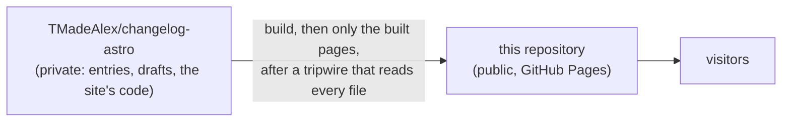
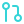

<!-- readme-standard: 2026-11-02 -->

#  TMadeAlex · the AstroLog

*Everything done to TMade Alex's home on GitHub, in plain words, newest first.*

Set up as a gift by a member of TMade Alex's community, so he can keep up with every change to his home. What stays
here is TMade Alex's to decide.

 **You are here:** TMadeAlex › `changelog-astro-public` · public, served by GitHub Pages from `main` · twin of `changelog-astro` (private): only the built pages arrive here

##  TL;DR

1.  **Read it at [tmadealex.github.io/changelog-astro-public](https://tmadealex.github.io/changelog-astro-public/).** A changelog, a library, a ledger of every public change, and a map. Press `/` there to search it all.
2.  **Whose home this is.** TMade Alex: futures trader, streamer and host of TMade, and a fashion photographer in New York. His own site is [tmadealex.github.io](https://tmadealex.github.io/). Nothing here speaks for him.
3.  **Nothing is asked of anyone.** If this page is all there is, the first build has not arrived yet.

##  How this repository works

Every entry is written in a private repository. An automatic job builds the site, reads every file it is about to
publish (no keys, no notes, no picture or font outside `assets/`), and brings only the built pages here as one ordinary
commit. It never force-pushes, and `main` carries a deletion-only rule.

| This repository holds | Written by |
| --- | --- |
| this `README.md`, `LICENSE`, `LICENSE-CONTENT` | the first commit, and after that by pull request; the automatic copy never touches them |
| everything else (the pages, `assets/`, `arrival/`, `.nojekyll`) | the automatic copy only; never edited here |

The pages set no cookies, run no analytics, load nothing from another site, and ask search engines not to list them
until TMade Alex says otherwise.

##  Suggest a change

A page is corrected in the private repository it is built from, and the next build brings the correction here. For
this `README.md`, open an [issue](../../issues) or a pull request against `main`; a person with the role merges it.

TMadeAlex on GitHub · [profile](https://github.com/TMadeAlex) · code MIT, words CC BY-SA 4.0 (`LICENSE`, `LICENSE-CONTENT`); TMade, TRADERMADE and TMade Alex are his names and marks. Icons: Lucide (ISC), see <code>assets/icons/LICENSE</code>.
